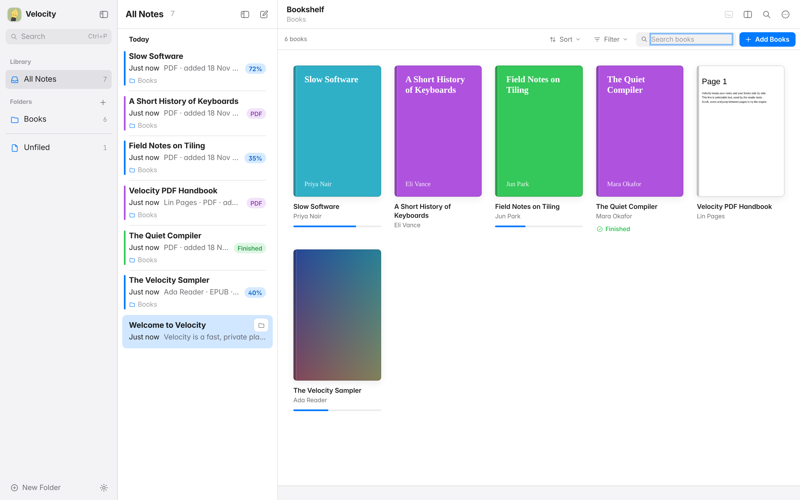
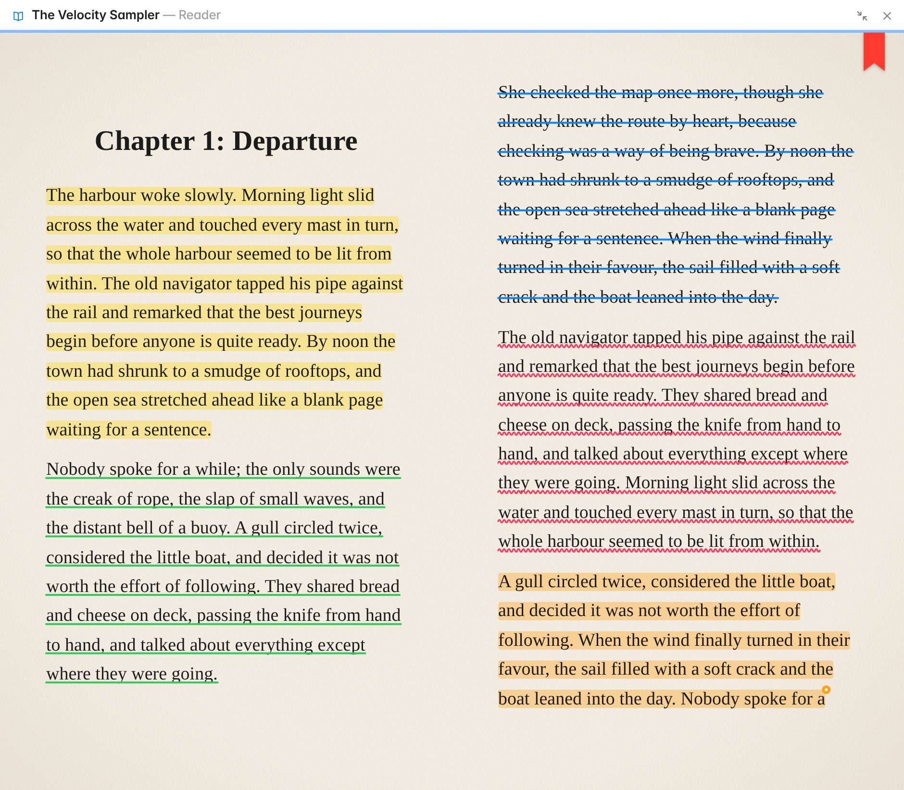

# Plugins

Velocity plugins are small, additive modules in the spirit of Obsidian community plugins.
A plugin can add **commands** (with keyboard shortcuts) to the command palette, **settings**
to Settings → Plugins, a **text prompt** in the palette, a **URL handler** that turns a URL
pasted into quick open (`Mod+P`) into an action, **note badges** that colour-code its notes
in the notes list, **workspace tiles** that sit beside a note, and an **editor mode** for notes
that are its kind of document. Core code never knows about a specific plugin.

Blog Reader is the first plugin and the reference implementation.

## Anatomy

```
client/src/plugins/
├── types.ts           # VelocityPlugin, PluginContext, PromptSpec, …
├── host.ts            # builds contexts, activates/disposes, exposes commands + URL handlers
├── registry.ts        # PLUGINS = [blogReader, …]  ← the one line you add
├── latex/             # live preview tile, PDF compile, .tex / PDF export
├── books/             # Bookshelf view, EPUB + PDF reader tile, quotes into the book's note
└── blogReader/
    ├── index.ts       # manifest, settings, activate(ctx)
    ├── extract.ts     # Readability + metadata (lazy-loaded)
    ├── markdown.ts    # DOM → Markdown
    └── note.ts        # note header / source URL
server/plugins/
├── types.ts           # ServerPlugin { id, name, router }
├── index.ts           # SERVER_PLUGINS, mountPlugins(app) → /api/plugins/<id>
├── shared/fetchPage.ts# SSRF-guarded page fetch (reusable connector transport)
├── latex/             # POST /api/plugins/latex/compile (TeX engine on the host)
├── books/             # /api/plugins/books: book files + one row per book (plugin_books)
└── blogReader.ts      # GET /api/plugins/blog-reader/fetch?url=
```

"Backend stores. Frontend thinks." still holds: a server plugin is only a transport for what
the browser can't do itself (cross-origin fetches, for example). Parsing and note creation stay on the
client, and notes are saved through the normal pastes API, so sync, search and Markdown export
work unchanged.

## Writing a plugin

```ts
// client/src/plugins/hello/index.ts
import type { VelocityPlugin } from '../types'

const hello: VelocityPlugin = {
  manifest: { id: 'hello', name: 'Hello', description: 'Says hello.', icon: 'doc.text', version: '1.0.0' },
  settings: [{ key: 'greeting', type: 'text', label: 'Greeting', default: 'Hello' }],
  activate(ctx) {
    return {
      commands: [
        {
          id: 'insert',
          title: 'New Greeting Note',
          keys: ['Ctrl+Alt+Shift+KeyH'],
          run: () => ctx.notes.create({ title: 'Greeting', content: ctx.setting<string>('greeting'), folder: 'Hello' }),
        },
      ],
      dispose: () => {},
    }
  },
}
export default hello
```

Then add it to `PLUGINS` in `registry.ts`. Its commands show up in the palette under **Plugins**
as `Hello: New Greeting Note`, and in the shortcuts sheet. Settings → Plugins gets a toggle and
the settings rows. Built-in shortcuts always win over plugin shortcuts.

### `PluginContext`

| Member | What it does |
|---|---|
| `setting(key)` | Current value, falling back to the manifest default |
| `storage.get/set` | Per-plugin JSON bag in `localStorage` (`velocity.plugin.<id>.v1`) |
| `flash(msg)` / `activity(msg \| null)` | Status-bar message (brief) / long-running status. There are no toasts |
| `prompt(spec)` | Spotlight-style text input. `↩` submits and `⌘↩` submits with `split: true` |
| `pick(spec)` | Palette list mode: the user filters and picks one item. Items can have sections, a badge, and be disabled with a hint |
| `panel.open / close / isOpen` | A large plugin-rendered panel over the workspace (one at a time; Escape closes it) |
| `api.get(path)` / `api.post(path, body)` | `/api/plugins/<id><path>`, unwraps the `{ success, data, error }` envelope; both take `{ headers }` (errors keep their HTTP `status`) |
| `api.stream(path, handlers, opts)` | Server-sent events read over `fetch`, so a token header can be sent; reconnects with back-off; returns a stop function |
| `notes.create / open / exists / current` | Create a note (in a folder, optionally in a new tile and in Read mode), open one, and so on |
| `notes.title / content / append / selection` | A note's title, its Markdown (loaded if needed), append Markdown, the editor selection |
| `notes.useContent(id)` | React hook for plugin components: the note's content, re-rendering as it changes |
| `notes.goToLine(id, line)` | Show the note in its editor with that line selected (e.g. a compiler error) |
| `views.open / close / isOpen` | A workspace view with no note behind it, from the plugin's `views` (see Workspace views) |
| `tiles.open / close / toggle / isOpen` | A workspace tile showing one of the plugin's `tiles` views for a note, beside the note's tile |
| `files.download(name, data, mime?)` | Hand the user a file (`Blob` or string) as a browser download |
| `boards.has / exportPng` | Whether the note has a whiteboard; render it to a PNG data URL with Excalidraw |
| `folders.ensure(name)` | Existing folder (case-insensitive) or a new one |
| `linkHandler` (instance field, not a ctx member) | Open `velocity://` links clicked in notes (see Links in notes) |
| `refreshBadges()` | Re-read this plugin's note badges after their state changes |

A `text` setting with `secret: true` is masked in Settings.

### Note badges

Return `noteBadge(noteId)` from `activate` to mark your notes in the sidebar list: a tinted edge
on the row and a small pill (`{ label, tone, title?, onClick? }`, where `tone` is a system colour
such as `blue` or `green`). With `onClick` the pill is a button, and its `title` also appears in the
row's context menu. Return `null` for notes the plugin doesn't own. It runs for every visible row,
so keep it cheap, and call `ctx.refreshBadges()` whenever the answer changes.

### Workspace tiles

Return `tiles: { <view>: { title, icon?, render(noteId) } }` from `activate`, then call
`ctx.tiles.open(view, noteId)`. The view gets its own tile beside the note's tile (a real tile:
focus, swap, zoom, close, drag and sliding columns all work). The layout stores it as
`{ kind: 'plugin', pluginId, view, noteId }`, so it is restored after a reload, follows the note's
temp → server id swap and closes when the note is deleted. While the plugin is off, the tile says
so instead of rendering. `render` is called by React, so lazy-load heavy components inside it and
keep state in a store; `ctx.notes.useContent(noteId)` keeps a view in step with the note.

### Workspace views

Return `views: { <view>: { title, icon?, render() } }` for a view that belongs to no note (a
bookshelf, a dashboard). `ctx.views.open(view)` focuses the view's tile if it is open, otherwise
fills the focused tile when that is empty, otherwise splits beside the focused tile;
`ctx.views.close(view)` closes it (the only tile becomes empty instead) and
`ctx.views.isOpen(view)` reports it. The layout stores `{ kind: 'view', pluginId, view }`, so it is
restored after a reload. The header shows the view's icon and title; while the plugin is off the tile
shows the same **Turn On** / **Close Tile** state as plugin tiles. Note-only commands (read mode,
close note tab) do not apply to a view tile.

### Folder actions

Return `folderAction(folder: { id, name })` to offer one action per sidebar folder, or `null` for
folders you do not decorate: `{ label, icon, run }`. It shows as a trailing icon button on the folder
row (on hover, focus or when selected), as the first item of the folder's context menu, and as a
button in the notes column header while that folder is selected. It is called on render, so keep it
cheap, and call `ctx.refreshBadges()` when its answer changes. Switching the plugin off removes it.

### Editor modes

Return `editorMode: { matches(content), extensions() }` to edit your kind of note with its own
CodeMirror language instead of Markdown and its live preview. `matches` sees the first 4,000
characters and runs as the user types, so keep it to a regex. The editor swaps modes in place
when the answer changes (no remount) and when plugins are switched on or off. The first running
plugin whose `matches` returns true wins.

### Links in notes

Return `linkHandler: { match(url: URL): boolean, open(url: URL, opts: { split: boolean }): void }`
to own in-app `velocity://` links, e.g. the Books highlights note links back with
`velocity://book/<id>?at=<locator>`. `match` sees the parsed URL (only `velocity:` links are ever
offered) and must be cheap; the first running plugin that matches wins, and nothing is offered while
the plugin is off. In **Read mode** a plain click opens the link (Mod/Ctrl+click passes
`split: true`) and never navigates the page. In the **editor** a link opens on Mod/Ctrl+click
(plain click just places the cursor); the same gesture opens http(s) links in a new tab. A
`velocity://` link nobody handles flashes "Nothing can open this link". Use `open` to do what the
link says (open a tile, jump to a position); honour `split` the way `ctx.tiles` / `ctx.views` do.
The host side is `linkHandlerFor(href)` in `host.ts`.

### Switching plugins off and on

Every plugin is on by default and has a switch in Settings → Plugins (**Plugins…** in the command
palette opens that section). Switching one off calls its `dispose()` and takes away everything it
added: its commands and keys, URL handler, note badges, folder actions and editor mode. The host also closes its
panel if it left one open. Its tiles stay in the layout and say the plugin is off, with **Turn On**
and **Close Tile** buttons, so switching it back on puts them back as they were. Server routes don't
change; they have their own settings (for example `HERDR_CONNECTOR_TOKEN`, `LATEX_COMPILE`).

A plugin's `dispose()` must undo what `activate()` started: timers, streams, store
subscriptions, object URLs. `host.test.ts` switches every registered plugin off and on.

Enabled state and settings are stored per browser in `velocity.plugins.v1`, like other preferences.

## Server side (optional)

```ts
// server/plugins/hello.ts
import { Hono } from 'hono'
import type { ServerPlugin } from './types.ts'
const router = new Hono()
router.get('/ping', (c) => c.json({ success: true, data: 'pong' }))
export const helloPlugin: ServerPlugin = { id: 'hello', name: 'Hello', router }
```

Add it to `SERVER_PLUGINS` in `server/plugins/index.ts`. It is served at `/api/plugins/hello/ping`.
A plugin with its own tables sets `migrate()` (run once when plugins are mounted, at startup); one
with timers or connections sets `dispose()`.
To fetch remote pages, use `fetchPage()` from `shared/fetchPage.ts`. It allows only http(s), blocks
private and loopback hosts (set `PLUGIN_FETCH_ALLOW_PRIVATE=on` to allow them), re-checks every
redirect, and caps time (15 s) and size (5 MB).

## Blog Reader

- **Open:** `Ctrl+Alt+B` → paste a URL → `↩`. Or paste a URL into quick open (`Mod+P`) and pick
  **Open in Blog Reader**. `⌘↩` flips the "Open in" setting between a new tile and the current tile.
- The post opens as a note in the **Blogs** folder (created if it doesn't exist). By default it opens
  in a new tile beside the current note, in Read mode, so you can read it, take notes or draw a
  whiteboard side by side. `Mod+E` switches to editing so you can annotate the article itself.
- The note starts with a source header (`> [Site](url) · Author · Date`, `> Saved … · n min read`),
  followed by the article as Markdown: headings, lists, code fences with their language, tables,
  quotes and images (remote URLs, rendered inline).
- Opening the same URL again opens the existing note. **Blog Reader: Refresh Article** fetches
  the current article again and replaces its content.
- **Read status:** every Blog Reader note is colour-coded in the notes list: a blue **Unread**
  pill and edge, or a green **Read** one. Click the pill, use the row's context menu, or press
  `Ctrl+Alt+Shift+B` (**Blog Reader: Mark as Read / Unread**) on the open post to flip it. The
  state is kept per browser in the plugin's storage, and survives **Refresh Article**.
- Settings: folder name, open in new or current tile, Read mode, include images, colour-code read status.

## Books

Read EPUB and PDF books beside your notes. Books live on your Velocity server, so the library, covers
and reading positions follow you to every device.





More: [dark](screenshots/books-v2/02-paper-dark-epub.jpg), [page curl](screenshots/books-v2/03-page-curl.jpg), [Visual Options](screenshots/books-v2/04-visual-options.jpg), [highlights note](screenshots/books-v2/08-highlights-note.jpg), [themes](screenshots/books-v2/11-themes-grid.jpg), [phone](screenshots/books-v2/12-phone.jpg).

- **Add:** **Books: Add Books…** (`Ctrl+Alt+Shift+O`), the **Add Books** button on the shelf, or drop EPUB / PDF
  files onto the shelf. Title, author, page count and cover are read in the browser (epub.js, pdf.js);
  the file is stored as it is. The same file added twice is kept once. Failures (too large, not an
  EPUB or PDF, server unreachable) show on a card with **Retry** and **Dismiss**.
- **Bookshelf:** the **Books** folder offers an **Open Bookshelf** button (folder row, its context menu and the
  notes-column header), or press `Ctrl+Alt+O`. It is a workspace view, not a note: a grid of covers
  (a generated cover when a book has none) with progress bars and a Finished mark, **Sort** (recently
  opened, title, author, date added, progress), **Filter** (reading, unread, finished; EPUB, PDF) and a
  search field. Right-click a card, or use its `…` button: Open, Open Notes, Mark as Unread / Finished,
  Rename…, Open Highlights, Download Original, Remove from Library… (asks first; it deletes the file, its note and its highlights).
- **Reader:** a tile beside your notes, built like a dedicated reader (Moon+ Reader is the model for behaviour,
  Velocity for the look). Spec: `docs/specs/books-reading-experience.md`.
  - **Layouts:** **Pages** (EPUB: one page, or a two-page spread when the tile is 900 px or wider; PDF: one fitted
    page at a time) or **Scroll** (EPUB continuous across chapters, PDF a virtualised column). Switching layout, text
    size, spacing or margins keeps the first visible text in view.
  - **Page turns** (Pages only): **Curl**, **Slide** (default), **Fade** or **None**; `prefers-reduced-motion` forces
    None. Tap zones: left 30 % previous, right 30 % next, middle shows or hides the chrome (a mouse tap in a turn
    zone waits 180 ms so a double or triple click can select text instead). Swipe on touch, horizontal trackpad scroll, keys
    `←` `→` `PageUp` `PageDown` `Space` / `Shift+Space` `Home` `End`. The top bar and the status line (chapter,
    `3 / 6` or `p. 12 of 300`, percent, a seekable progress track) fade after 3 s in Pages and return on a middle tap,
    a key press or the pointer near the top or bottom edge.
  - **Paper:** the default reader theme is a paper stock derived from the active Velocity theme (Apple, Catppuccin,
    Gruvbox, Everforest, Nord, Solarized, light and dark) with a soft grain and vignette, so the page reads as paper in
    every family and never as a white sheet in a dark one. **Auto** (plain app colours), **Light**, **Sepia** and
    **Dark** stay as fixed stocks. PDF pages are tinted to match (multiplied on light, inverted with a warm ink on dark).
  - **Visual Options** (the `Aa` button): Theme, Layout, Page turn, Font (Serif, Sans, Original), Size, Line spacing,
    Paragraph spacing, Margins (Narrow, Normal, Wide), Align (Left, Justify with hyphenation); for PDF Fit width / page
    and zoom 50 to 400 %. Changes apply live; **Reset** restores the defaults. Settings are kept per browser.
  - **Highlights:** select text and a floating toolbar offers four styles (highlight, underline, strikethrough,
    squiggly), five colours, **Copy**, **Note** and **Quote in Notes**. Choosing a style or colour creates the
    highlight at once and is remembered; `H` highlights the selection with the last style and colour. Click a
    highlight to change its style or colour, edit its note (`Ctrl/⌘+Enter` saves) or delete it. Notes show a small
    mark on the page. A press outside the tile closes the toolbar.
  - **Bookmarks:** the ribbon button or `B` toggles a bookmark on the current page (Scroll: current position); a
    bookmarked page shows a ribbon in its top-right corner while the chrome is hidden.
  - **Contents drawer:** three tabs, **Contents**, **Bookmarks** and **Highlights** (colour filter, a `…` menu per row:
    Go to, Edit Note, Copy, Delete, and **Clear All** with a confirm). Annotation text and notes are rendered as text
    everywhere (drawer, toolbar, sheet, highlights note), never as HTML.
  - PDF: sharp at any zoom, outline, selectable text, highlights stored as page rectangles. In Pages with Fit Page the
    saved position is `page:N` (an in-page offset only matters when the page is taller than the tile).
  - EPUB scripts never run: the page iframe and the page-turn snapshot iframe are sandboxed without `allow-scripts`.
- **Highlights note and links:** every annotated book gets one more note in the Books folder, **`<Book> — Highlights`**,
  rebuilt from its annotations (about 1 s after a change, and when opened): highlights grouped by chapter with colour
  dot, style, place, date and your note, then the bookmarks, each with a `velocity://book/<id>?at=<locator>` link back
  to that place (see **Links in notes** above). **Open Highlights** is in the reader's Notes menu and on the shelf card
  menu. Click a link in Read mode, or Ctrl/⌘+click it in the editor: the reader opens at that place, whether the
  reader tile is open or closed. The first line is a hidden marker (`<!-- velocity-book-highlights:<id> -->`).
- **Reopen where you left off:** the saved position is the first visible text (EPUB CFI; PDF `page:12` or
  `page:12@0.35`). After a reload, closing the tile, a layout change or opening on another device the book lands on
  that text, and the reader never writes an earlier place over it while it restores.
- **Notes and quotes:** every book has a note in the Books folder, made when the book is added. Its first
  line is a hidden marker (`<!-- velocity-book:<id> -->`) that the plugin owns; the editor folds it away
  and Read mode doesn't show it. Select text in the reader and choose **Quote in Notes** to append
  `> passage` with `— *Chapter* · 42%` (PDF: `— p. 12`) to that note.
- **Reading position:** local-first. Each page turn updates the tile at once and is kept in the plugin's
  storage; the server row is updated about 1.5 s later (and on tab close), and on open the newer of the two wins.
  A book is Finished from 98 %. Reload restores the Bookshelf and Reader tiles.
- Notes-list badges: EPUB / PDF while unread, a percentage while reading, Finished. Click one to open the book.
- Commands: Open Bookshelf (`Ctrl+Alt+O`), Add Books… (`Ctrl+Alt+Shift+O`), Open in Reader (when a book note is open).
- Settings: Books folder name (default `Books`), badges in the notes list.

### Server

`server/plugins/books/`: `index.ts` (routes), `files.ts` (streaming upload, sniffing, Range), `store.ts`
(`plugin_books`), `annotations.ts` (highlights and bookmarks). Files are stored as `<id>.epub` / `<id>.pdf` in `BOOKS_DIR` (default `data/books`, which the
Docker volume covers). `POST /api/plugins/books` takes the raw file as the body with an `X-File-Name` header;
the format is sniffed from the bytes (an upload that is neither a PDF nor an EPUB is a 415), the body is
hashed while it streams to disk, and anything over `BOOKS_MAX_BYTES` (200 MB) is a 413. `GET /:id/file` supports
`Range` and an ETag, so a large PDF opens without downloading all of it. Reverse proxies need a matching body
limit: the bundled nginx configs set `client_max_body_size 200m;` on `/api/`; raise it together with
`BOOKS_MAX_BYTES`. Nothing leaves your server, and nothing is fetched from the internet.

## Herdr

Shares a note with a coding agent that is already running in [herdr](https://herdr.dev) (Claude
Code, Codex, OpenCode and the rest) and follows every conversation on one **Agents board**. Velocity
starts no agent processes: it is a client of herdr's local socket API.

### Setup

1. Run herdr 0.9.0 or later and start agents in its panes. For Claude Code, also run
   `herdr integration install claude`, so summaries can be read from Claude's transcript.
2. On the Velocity server, set `HERDR_CONNECTOR_TOKEN` (any long random string). Without it every
   `/api/plugins/herdr` route answers 503. `HERDR_SOCKET_PATH` or `HERDR_SESSION` choose the socket;
   the default is `~/.config/herdr/herdr.sock`.
3. In Settings → Plugins → Herdr, paste the same token.

### Use

- **Share Note with Agent** (`Ctrl+Alt+G`): the first send to an agent is the note's title and every
  paragraph; after that only paragraphs Velocity hasn't sent before (it keeps fingerprints, never
  the text). A selection is sent as it is. **Share Note with Another Agent…** (`Ctrl+Alt+Shift+G`)
  always opens the agent picker. Agents that need you can't be picked.
- **Attachments:** images embedded from Velocity (`/api/assets/<id>`) and the note's whiteboard (a PNG
  rendered in the browser plus the Excalidraw scene) are written to
  `<agent folder>/.velocity/attachments/<turn>/`; the prompt points at those files and `.velocity/` is
  added to the repo's `.git/info/exclude`. When Velocity runs in Docker, set
  `HERDR_ATTACHMENTS_DIR` (a folder the container can write) and `HERDR_ATTACHMENTS_HOST_DIR` (the
  same folder on the host); agents may then ask permission to read files outside their own folder.
- **Summaries:** each send ends by asking the agent for a summary of what it implemented between
  `<velocity-summary id="…">` marker lines. When herdr reports the agent idle, Velocity reads that
  block, whole, from Claude Code's transcript or from the agent's screen. Without a block it keeps
  the final message (Claude Code). The transcript itself is never stored.
- **Agents board** (`Ctrl+Alt+A`): Shared, Working, Blockers, Completed, following herdr's live state.
  Click a card for the conversation: each turn's summary with Copy and **Add summary to note** (an
  `### Outcome · <agent> · <time>` section; Off / Ask / Always in Settings), the agent's screen for
  blockers, and **Open in herdr**. Velocity never answers approvals.
- Note badges: Shared, Working, Needs you, New summary, Summary, Didn't finish, Check agent.

### Server pieces

`server/plugins/herdr/`: `socket.ts` (NDJSON client with a method allow-list: no raw keys, no shell
input, no layout changes), `service.ts` (prompt + wait, Needs you, restart recovery, agent polling),
`summary.ts`, `transcript.ts`, `attachments.ts`, `store.ts` (`plugin_herdr_conversations`,
`plugin_herdr_turns`). Tests run against `server/tests/fixtures/fakeHerdr.ts`.

Not built yet: a host bridge for Docker Desktop (Unix sockets don't cross its VM), showing the board
as a workspace tile beside the editor (it is a panel for now), and margin marks on sent paragraphs.

## LaTeX

Write LaTeX in a note and read it typeset beside it, then compile to a real PDF on the server.

- **New LaTeX Document** (palette) creates a note from a template in the **LaTeX** folder and opens
  the preview beside it. Any note works: one with `\documentclass` (or `\begin{document}`) is a
  full document; anything else is a body that compiles inside an article preamble (amsmath,
  amssymb, amsthm, graphicx, hyperref, plus `\newtheorem`s for the theorem environments it uses).
- **Toggle Live Preview** (`Ctrl+Alt+X`, or click the note's **TeX** pill): a tile with the
  document typeset as you type: title block, numbered sections and table of contents, lists,
  tables, figures and captions, theorems and proofs, footnotes, `\label` / `\ref` / `\eqref` / `\cite`,
  verbatim and listings, and maths with KaTeX (equations numbered, `\newcommand` macros work in
  maths and text). It is a preview, not TeX: unknown commands show muted and are listed in the
  tile's status line, and TikZ shows a placeholder.
- **Compile to PDF** (`Ctrl+Alt+Shift+X`): the tile's **PDF** view shows the PDF from the server's
  TeX engine. Errors and warnings are listed with their line; click one to jump to it in the note
  (lines of a wrapped body are mapped back). With **Recompile as you type** on, the PDF view
  compiles again 1.5 s after you stop typing.
- **Export as .tex** saves the source (a body is saved wrapped, so it compiles on its own).
  **Export as PDF** compiles if needed and saves the PDF. Without a TeX engine on the server it
  prints the live preview instead (choose "Save as PDF" in the print dialog).
- `\documentclass` notes are edited with LaTeX syntax highlighting instead of rich Markdown.
- Settings: TeX engine (Auto, latexmk, pdfLaTeX, XeLaTeX, LuaLaTeX, Tectonic), recompile as you type,
  folder for new documents, TeX pills in the notes list.

### Server

Compiling needs a TeX distribution on the machine running the Velocity server: TeX Live,
MiKTeX or Tectonic, with `latexmk`, `pdflatex`, `xelatex`, `lualatex` or `tectonic` on `PATH`. In
Docker, build the server image with `LATEX=on docker compose build server` (adds a TeX Live subset).
`GET /api/plugins/latex/status` reports what was found.

`POST /api/plugins/latex/compile { source, engine? }` writes the source to a fresh temporary folder,
runs the engine there (reruns for cross-references) and deletes the folder. Nothing is stored. Shell
escape is off, kpathsea runs in paranoid mode (`openin_any=p`, `openout_any=p`: no absolute paths,
no `..`, no dot files), latexmk ignores rc files (`-norc`) and Tectonic runs `--untrusted`. A run is
killed with its process group after `LATEX_TIMEOUT_MS` (30 s). Sources are capped at 2 MB, PDFs at
`LATEX_MAX_PDF_BYTES` (20 MB), and `LATEX_MAX_CONCURRENT` (2) engines run at once with up to 8
waiting (then 429). TeX errors are not HTTP errors: the answer is `{ ok, pdf (base64), log, issues,
engine, durationMs }`. `LATEX_ENGINE` picks the default engine, `LATEX_BIN_DIR` is searched before
`PATH`, and `LATEX_COMPILE=off` turns compiling off (503).

Images: `\includegraphics` with an `https://` URL or a Velocity asset (`/api/assets/<id>`) shows in
the live preview; the TeX engine only sees the note, so the PDF shows images it can find itself.

**Annotations API** (`server/plugins/books/annotations.ts`, table `plugin_book_annotations`, deleted with the book):
`GET /api/plugins/books/:id/annotations` (ordered by progress), `POST` (Zod: `kind` highlight or bookmark, `locator`
1 to 4000 chars, `text` up to 10 000 and required for highlights, `note` up to 10 000, `color` yellow / green / blue /
pink / orange and `style` highlight / underline / strike / squiggle required for highlights and null for bookmarks,
`chapter` up to 300, `progress` 0 to 1, `page` integer; a bookmark at an existing locator returns the existing row),
`PATCH /:id/annotations/:aid` (`color`, `style`, `note`), `DELETE /:id/annotations/:aid` and
`DELETE /:id/annotations?kind=highlight|bookmark` (clear all of a kind). The client store (`annotations.ts`) is
local-first: changes show at once and a background queue writes them with the same retry rules as reading position.
